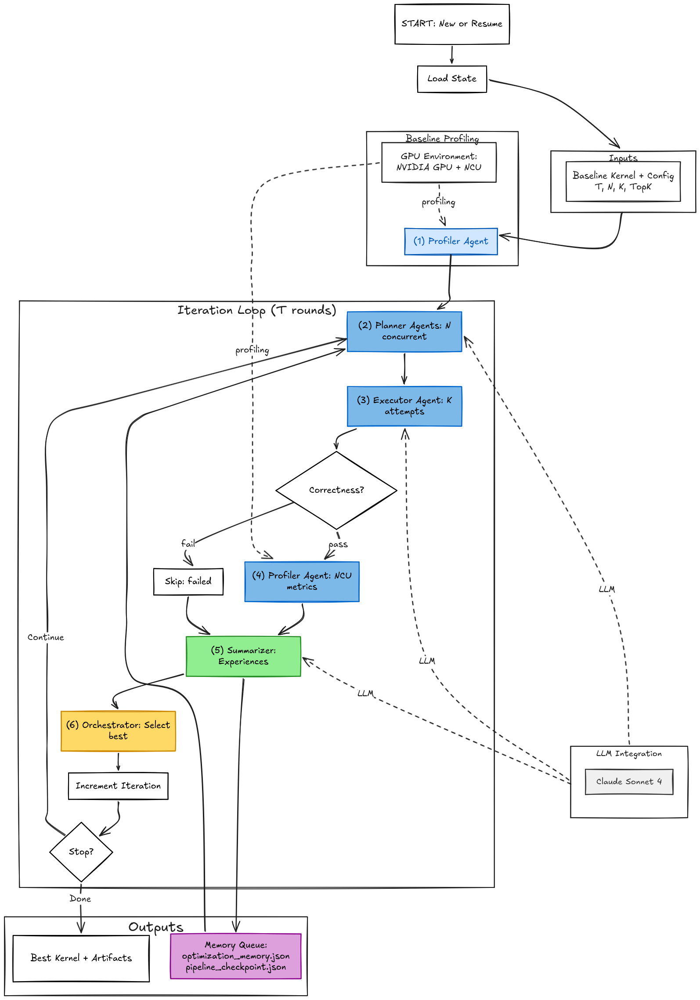

# kernelopt

Multi-agent GPU kernel optimizer. Automatically profiles a kernel with Nsight Compute (NCU), generates diverse optimization plans, applies them, verifies correctness, and iterates — building an experience memory that improves plan quality over time.

Supports **Triton**, **CUDA**, and **Helion** kernels. Powered by **LangGraph** + **Claude on Vertex AI**.

---

## Quick Start

```bash
# 1. Install
pip install -e "kernelopt/.[triton]"

# 2. Configure Vertex AI credentials
kernelopt setup

# 3. Optimize a kernel!
CUDA_VISIBLE_DEVICES=0 kernelopt run tests_suite/fixtures/kernels/matmul_triton.py -T 3 -N 4
```

---

## How it works

Each iteration runs six phases in a LangGraph pipeline:



**Stopping conditions**: max T iterations reached, 2 consecutive iterations with no improvement, or all plans report low confidence.

**Resume logic**: When using `--checkpoint`, the pipeline detects the last checkpoint stage and continues from there (e.g., if stopped at `after_plans`, it skips re-generating plans and goes straight to execution).

### Complete Flow with Checkpoints

```
┌─────────────────────────────────────────────────────────────────┐
│ START: kernelopt run kernel.py -T 5 -N 4                        │
│   or: kernelopt run kernel.py --checkpoint <run_dir>/  (resume)    │
└──────────────────┬──────────────────────────────────────────────┘
                   │
                   ▼
       ┌───────────────────────┐
       │ Load/Create State     │
       │ - New: Initialize     │
       │ - Resume: Load from   │
       │   pipeline_checkpoint │
       └───────────┬───────────┘
                   │
                   ▼
┌──────────────────────────────────────────────────────────────────┐
│ BASELINE PHASE (once, or skip if resuming with checkpoint)      │
├──────────────────────────────────────────────────────────────────┤
│ (1) Profiler Agent: profile_baseline()                          │
│     - Run NCU on original kernel                                │
│     - Parse profiling context                                   │
│     Checkpoint: after_baseline                                  │
└──────────────────┬───────────────────────────────────────────────┘
                   │
                   ▼
       ┌───────────────────────┐
       │ ITERATION LOOP        │
       │ (up to T iterations)  │
       └───────────┬───────────┘
                   │
    ┌──────────────┴──────────────┐
    │                             │
    ▼                             │
┌──────────────────────────────────────────────────────────────────┐
│ PLANNING PHASE                                                   │
├──────────────────────────────────────────────────────────────────┤
│ (2) Planner Agents: generate_plans()                            │
│     - N concurrent planner agents                               │
│     - Each gets diversity hint + memory                         │
│     - Generate OptimizationPlan (direction, steps, confidence)  │
│     Checkpoint: after_plans                                     │
│     (Resume skips if already at this stage)                     │
└──────────────────┬───────────────────────────────────────────────┘
                   │
                   ▼
┌──────────────────────────────────────────────────────────────────┐
│ EXECUTION PHASE                                                  │
├──────────────────────────────────────────────────────────────────┤
│ (3) Executor Agents: execute_plans()                            │
│     - N concurrent executor agents                              │
│     - K attempts per plan                                       │
│     - Apply optimizations to kernel                             │
│     - Correctness check (agentic or static)                     │
│     Checkpoint: after_execute                                   │
└──────────────────┬───────────────────────────────────────────────┘
                   │
                   ▼
              ┌─────────┐
              │ Pass    │ Correctness Check
              │ Check?  │
              └────┬────┘
                   │
         ┌─────────┴──────────┐
         │                    │
      PASS                  FAIL
         │                    │
         ▼                    ▼
┌─────────────────┐   ┌──────────────────┐
│ PROFILING       │   │ Skip profiling   │
│ (4) NCU on      │   │ (broken kernel)  │
│ passing         │   │                  │
│ candidates      │   │                  │
│ CP:after_profile│   │                  │
└────────┬────────┘   └────────┬─────────┘
         │                     │
         └──────────┬──────────┘
                    │
                    ▼
┌──────────────────────────────────────────────────────────────────┐
│ SUMMARIZATION PHASE                                              │
├──────────────────────────────────────────────────────────────────┤
│ (5) Summarizer Agent: summarize_results()                       │
│     - Compare slow/fast kernels (or note failure)               │
│     - Extract experience_item                                   │
│     - Update optimization memory (FIFO queue)                   │
│     Checkpoint: after_summarize                                 │
│     Save: optimization_memory.json                              │
└──────────────────┬───────────────────────────────────────────────┘
                   │
                   ▼
┌──────────────────────────────────────────────────────────────────┐
│ SELECTION PHASE                                                  │
├──────────────────────────────────────────────────────────────────┤
│ (6) Orchestrator: select_best()                                 │
│     - Pick best candidate from this iteration                   │
│     - Update best_kernel if improvement                         │
│     - Update optimization_log.md                                │
│     Checkpoint: after_select                                    │
│     Save: best_kernel.{py|cu|hl}                                │
└──────────────────┬───────────────────────────────────────────────┘
                   │
                   ▼
       ┌───────────────────────┐
       │ Increment Iteration   │
       │ Checkpoint:           │
       │    iteration_{N}      │
       └───────────┬───────────┘
                   │
                   ▼
           ┌───────────────┐
           │ Check Stopping│
           │ Conditions    │
           └───────┬───────┘
                   │
        ┌──────────┴──────────┐
        │                     │
     Continue?              Stop?
        │                     │
        │  - Iteration < T    │  - Max iterations
        │  - Improvement      │  - 2x no improvement
        │    found            │  - Low confidence
        │                     │
        +-> Loop back           +-> Output & Exit
             to (2)                │
                                   ▼
                          ┌─────────────────┐
                          │ FINAL OUTPUT    │
                          ├─────────────────┤
                          │ - best_kernel   │
                          │ - memory.json   │
                          │ - checkpoint    │
                          │ - log.md        │
                          │ - all artifacts │
                          └─────────────────┘
```

**Key Points:**
- **Checkpoint saved** after every major stage
- **Resume**: Load state from `pipeline_checkpoint.json`, jump to last incomplete stage
- **Fail path**: Correctness failures skip profiling but still generate negative experience
- **Loop**: Continues until T iterations or stopping condition met
- **Output**: All artifacts in timestamped `run_<timestamp>/` directory

---

## Pipeline State Management & Checkpointing

kernelopt automatically saves pipeline state throughout execution, allowing you to **pause and resume** optimization runs at any time.

### Checkpoint Mechanism

The pipeline saves checkpoints after each major stage:

```
pipeline_checkpoint.json updated after:
  - Baseline profiling complete
  - Plans generated (all N plans ready)
  - Plans executed (before NCU profiling)
  - Candidates profiled (NCU complete)
  - Results summarized (memory updated)
  - Best candidate selected
  - Each iteration complete
```

**What gets saved:**
- Full pipeline configuration (T, N, K, models, NCU flags, kernel args)
- Current iteration number and best speedup
- Optimization memory (experience items)
- Profiling context (baseline metrics)
- All candidate results from completed iterations
- Last completed stage (for resume logic)

### Resuming from Checkpoint

Use `--checkpoint <run_directory>` to resume a previous run:

```bash
# Original run (interrupted or completed)
kernelopt run softmax.py -T 5 -N 4 -K 1
# Creates: pipeline_output/run_20260414_120000_000000/

# Resume from checkpoint (continues where it left off)
kernelopt run softmax.py --checkpoint pipeline_output/run_20260414_120000_000000/

# Resume with MORE iterations (override T only)
kernelopt run softmax.py -T 10 --checkpoint pipeline_output/run_20260414_120000_000000/
```

**Resume behavior:**
- **Same kernel basename required** (e.g., both `softmax.py`)
- **Reloads full config** from checkpoint (NCU settings, models, kernel args)
- **Only T/N/K can be overridden** from CLI (omit to use saved values); **`--hud`** is always taken from the current shell (not stored in checkpoint)
- **Continues from last checkpoint stage:**
  - After `after_plans`: Re-uses existing plans (doesn't regenerate)
  - After `after_execute`: Continues with profiling
  - After iteration N: Starts iteration N+1
- **All other flags ignored** during resume (`-o`, `--run-subdir`, `--model`, etc.)

**Use cases:**
- **Job timeout:** Resume after cluster time limit
- **Iterative tuning:** Start with `-T 3`, then extend with `-T 10`
- **Checkpoint inspection:** Examine `pipeline_checkpoint.json` to see progress

### Output Structure

Every `kernelopt run` creates a timestamped directory under `--output-dir` (default: `pipeline_output/`):

```
pipeline_output/
└── run_20260414_120000_000000/          # Unique run directory
    ├── pipeline_checkpoint.json         # Resume state
    ├── optimization_memory.json         # Experience items
    ├── optimization_log.md              # Human-readable log
    ├── best_kernel.py                   # Best optimized kernel
    ├── baseline.csv                     # Baseline NCU profile
    ├── baseline.ncu-rep                 # Baseline NCU raw data
    ├── baseline_profiling_context.json  # Parsed baseline metrics
    ├── softmax_kernel_iter1_plan0_reduce_bank_conflicts.py
    ├── softmax_kernel_iter1_plan0_reduce_bank_conflicts.csv
    ├── softmax_kernel_iter1_plan0_reduce_bank_conflicts.ncu-rep
    ├── softmax_kernel_iter1_plan0_reduce_bank_conflicts_profiling_context.json
    └── ... (more candidates from other iterations)
```

**Key files:**
- `pipeline_checkpoint.json` — Resume state (automatically created/updated)
- `optimization_memory.json` — Experience memory (grows over iterations)
- `optimization_log.md` — Per-iteration summary with metric tables
- `best_kernel{.py|.cu|.hl}` — Best kernel found so far (updated each iteration)
- `baseline.*` — Original kernel profiling artifacts
- `{kernel}_iter{N}_plan{L}_{direction}.*` — Each candidate's artifacts

**Flat layout (no timestamped subdirectory):**

```bash
kernelopt run softmax.py -o pipeline_output --no-run-subdir
# Writes directly to: pipeline_output/ (overwrites on repeat runs)
```

Use `--no-run-subdir` when you want predictable paths (CI/CD, scripting) or are managing directories manually.

---

## GPU Monitoring

`kernelopt run` automatically displays GPU and system status before profiling and monitors GPU activity during optimization.

### Pre-run Validation

Before starting the optimization pipeline, kernelopt shows:

```
System Status:
  CPU Memory (RAM): 1700 MB available / 1805 MB total (94.2% available)
  GPU Device: GPU 0 (NVIDIA H200)
  GPU Memory (VRAM): 130070 MB free / 143771 MB total (90.5% free)
  GPU Utilization: 0.0%
  GPU Temperature: 30°C
  Active processes: 7 (12920 MB GPU memory)

   Active GPU Processes    
 User      PID  GPU Memory 
 host  2605259     4782 MB 
 host  3331695     3544 MB 
 ...
```

**Features:**
- **System RAM** and **GPU VRAM** clearly labeled to avoid confusion
- **GPU utilization** and **temperature** monitoring
- **Active GPU processes** with memory usage breakdown
- **Warnings** if GPU memory is low (<40% free) or GPU is busy (>20% utilization)

### Per-iteration Monitoring

During optimization, kernelopt monitors GPU activity at the start of each iteration (silent when idle):

```
Iteration 2/5  Best: 1.42x  Memory: 4 items
  GPU activity: GPU utilization: 38.3% | 2 processes using 5248 MB
```

**Non-blocking design:** All monitoring is informational only — warnings are displayed but execution never halts.

### Container Support

When running inside containers (Docker, devcontainers), GPU processes from the host system are labeled as `"host"`:

```
   Active GPU Processes    
 User      PID  GPU Memory 
 host  2605259     4782 MB 
 host  3331695     3544 MB 
  Note: 'host' = process running outside container namespace
```

**Limitations in containers:**
- GPU memory usage per process (accurate)
- Total GPU utilization (accurate)
- System RAM status (accurate)
- Process usernames: shows `host` for processes outside the container (not accurate per-user)
- CPU% usage: hidden, not accessible due to PID namespace isolation

**For full process details**, run kernelopt directly on the host system (not in a container).

---

## Agents

### Planner (`agents/planner/`)

LangGraph sub-graph: `agent → tools → agent → ... → submit_plan`.

- N instances run **concurrently** via `ThreadPoolExecutor`.
- Each instance receives a diversity hint pointing it at a different NCU optimization rule.
- Cross-iteration direction history prevents repeating tried strategies.
- Output: an `OptimizationPlan` (Pydantic-validated) with `direction`, `evidence`, `steps`, and `confidence`.

### Executor (`agents/executor/`)

LangGraph sub-graph: `agent → tools → agent → ... → submit_kernel`.

- Reads the current best kernel and the planner's optimization plan.
- Up to K attempts; each `submit_kernel` call validates kernel markers (`@triton.jit`, `__global__`, `@helion.kernel`, `@hl.kernel`).
- Returns `(optimized_source, execution_result)` with `ready_for_profiling` flag.

### Profiler (`agents/profiler.py`)

Stateless — no LLM involved.

1. Runs `ncu --set full` → `.ncu-rep`
2. Exports CSV via `ncu --import`
3. Parses sections, rules, and launch stats into a structured `profiling_context` dict
4. Auto-detects framework via AST (Python) or regex (CUDA)
5. Enriches context with GPU hardware specs (SM count, HBM bandwidth, compute capability)

### Summarizer (`agents/summarizer.py`)

Single LLM call with structured output.

- Diffs the slow/fast kernel pair.
- Produces an `experience_item` (generalizable insight) and a `memory_update` action (`append` / `replace` / `skip`).
- Correctness-failure items (no profiling) bypass speedup thresholds and go directly into memory so the planner avoids repeating broken implementations.

### Correctness Checker (`functions/correctness.py`)

- **Agentic mode** (default): Claude generates a CPU reference implementation and validates numerical outputs.
- **Non-agentic mode**: `--no-agentic-correctness` flag uses a simpler static check.

---

## Optimization Memory

A bounded FIFO queue (capacity `ExpN`, default 8) of `experience_items`.

| Parameter | Default | Description |
|-----------|---------|-------------|
| `ExpN` | 8 | Queue capacity |
| `TopK` | 4 | Max items added per iteration |
| `t_pos` | 1.04 | Min speedup to store a positive item |
| `t_neg` | 1.15 | Min slowdown factor to store a negative item |

Each item records: `direction`, `speedup`, `rewrite_type` (positive/negative), `profiling_signal`, `strategy_description`, `slow_pseudocode`, `fast_pseudocode`, `applicable_when`, `do_not_apply_when`.

The planner reads this memory to avoid dead ends and reinforce strategies that worked.

---

## State

| Class | Role |
|-------|------|
| `PipelineConfig` | User-facing parameters (T, N, K, TopK, model, NCU flags, …) |
| `PipelineState` | Full mutable runtime state (best kernel, memory, iteration results) |
| `GraphState` | LangGraph `TypedDict` projection of `PipelineState` |
| `PlanCandidate` | One plan's execution + profiling results |
| `IterationResult` | All candidates for one iteration + which was kept |

---

## Installation

### Quick Setup (Recommended)

**One command after install:**

```bash
# Step 1: Install
pip install -e ".[triton]"

# Step 2: Configure (interactive wizard — sets Vertex AI project, region, auth)
kernelopt setup

# Step 3: Test
CUDA_VISIBLE_DEVICES=0 kernelopt run tests_suite/fixtures/kernels/matmul_triton.py -T 1 -N 1
```

`kernelopt setup` will:
- Prompt for your Google Cloud **project ID** and **region**
- Save config to `~/.config/kernelopt/config.toml` (no manual `source` needed)
- Check/run Google Cloud authentication (`gcloud auth application-default login`)
- Verify GPU, NCU, and Vertex AI connectivity

Run `kernelopt doctor` at any time to re-check your environment.

### Manual Setup (Advanced)

If you prefer manual installation or need custom configuration:

```bash
# 1. Install kernelopt package
cd kernelopt
pip install -e ".[triton]"   # Triton support
pip install -e ".[dev]"      # Development tools (pytest, ruff, mypy)
cd ..

# 2. Configure environment
export ANTHROPIC_VERTEX_PROJECT_ID=your-project-id
export VERTEX_REGION=us-east5

# 3. Set up authentication
gcloud auth application-default login

# 4. Load environment
source .env

# 5. Install procps-ng (for GPU process monitoring)
sudo dnf install -y procps-ng    # RHEL/Fedora
# or: sudo apt install -y procps  # Ubuntu/Debian
```

**System Requirements:**
- Python 3.10+
- `ncu` (Nsight Compute) on `$PATH`
- CUDA-capable GPU with compute capability >= 6.0
- Google Cloud project with Vertex AI API enabled
- gcloud CLI installed
- `procps-ng` package (provides `ps` command for GPU monitoring)

### Common Setup Issue

**Problem:** `kernelopt` complains about missing Vertex AI credentials

```bash
Error: ANTHROPIC_VERTEX_PROJECT_ID environment variable not set
```

**Solution:** You forgot to load the environment variables! Run:

```bash
source .env
```

**Why?** You haven't run `kernelopt setup` yet, or `ANTHROPIC_VERTEX_PROJECT_ID` is not set. Run `kernelopt setup` to configure credentials, or set the env var manually.

### GPU Selection (`CUDA_VISIBLE_DEVICES`)

`CUDA_VISIBLE_DEVICES` is a standard CUDA environment variable that controls which GPU(s) are visible to your program. kernelopt (and NCU) will only see and use the GPUs you specify.

**Why use it?** On multi-GPU machines, NCU profiling requires exclusive access to a GPU. Setting `CUDA_VISIBLE_DEVICES` ensures kernelopt uses a specific GPU and avoids interfering with other users or processes on shared machines.

```bash
# Use only GPU 0
CUDA_VISIBLE_DEVICES=0 kernelopt run softmax.py -T 3 -N 4

# Use only GPU 2 (e.g., if GPUs 0 and 1 are busy)
CUDA_VISIBLE_DEVICES=2 kernelopt run softmax.py -T 3 -N 4

# Use GPUs 0 and 1 (for multi-GPU workloads)
CUDA_VISIBLE_DEVICES=0,1 kernelopt run softmax.py -T 3 -N 4
```

**How to check which GPUs are available:**

```bash
nvidia-smi  # shows all GPUs with utilization and memory usage
```

Pick a GPU with low utilization and enough free memory. For kernelopt, a single GPU is sufficient — most kernel profiling targets one GPU at a time.

**Tip:** If you don't set `CUDA_VISIBLE_DEVICES`, kernelopt will use GPU 0 by default. On shared machines, always set it explicitly to avoid conflicts.

---

## CLI

```
kernelopt run <kernel.py|.cu|.hl>   # full optimization pipeline
kernelopt profile <kernel>          # single NCU profiling run
kernelopt show <ncu.csv>            # pretty-print a profile CSV
kernelopt plan <ncu.csv> <kernel>   # generate plans only (no execution)
kernelopt kernels <ncu.csv>         # list all kernels in an NCU CSV
```

### `kernelopt run` options

| Flag | Default | Description |
|------|---------|-------------|
| `-T`, `--iterations` | 5 | Max optimization iterations (omit = default 5; when using `--checkpoint`, from saved checkpoint if omitted) |
| `-N`, `--plans` | 4 | Plans per iteration (omit = default 4; when using `--checkpoint`, from saved checkpoint if omitted) |
| `-K`, `--attempts` | 1 | Executor attempts per plan (omit = default 1; when using `--checkpoint`, from saved checkpoint if omitted) |
| `--top-k` | 4 | Max experience items added per iteration |
| `-o`, `--output-dir` | `pipeline_output/` | Output **base** directory for `kernelopt run` (see Outputs) |
| `--run-subdir` / `--no-run-subdir` | on | **Every** `kernelopt run` creates `run_<timestamp>/` under `-o` (default: on) |
| `--csv` | — | Skip baseline profiling, use existing NCU CSV |
| `--checkpoint` | — | **Resume** from checkpoint in run directory. Reloads full config from `pipeline_checkpoint.json` and continues from last completed stage. Only `-T`/`-N`/`-K` and `--hud` can be set from CLI (omit T/N/K to use saved values). See [Pipeline State Management](#pipeline-state-management--checkpointing). |
| `--hud` | off | **Same-terminal HUD**: alternate-screen status panel; **NCU + full stream** append to `kernelopt_terminal.log` in the run directory. Press **`t`** (when stdin is a TTY) to toggle between the HUD panel and a short tail of that log. Not stored in checkpoint. |
| `--kernel-name` | auto | NCU `--kernel-name` regex |
| `--launch-skip` | 0 | NCU `--launch-skip` |
| `--launch-count` | — | NCU `--launch-count` |
| `--replay-mode` | `kernel` | `kernel` or `application` |
| `--kernel-args` | — | Extra args forwarded to the kernel program |
| `--debug` | off | Print internal debug info: LLM profiler config, framework detection, NCU overrides |
| `--model` | `claude-sonnet-4@20250514` | Default model for all agents |
| `--planner-model` | — | Model override for the planner |
| `--executor-model` | — | Model override for the executor |
| `--summarizer-model` | — | Model override for the summarizer |
| `--project-id` | `$ANTHROPIC_VERTEX_PROJECT_ID` | Google Cloud project for Vertex AI |
| `--region` | `us-east5` | Vertex AI region |
| `--agentic-correctness / --no-agentic-correctness` | on | Use Claude for correctness checks |

### Live HUD (`--hud`)

Nsight Compute writes a lot of lines (`==PROF==`, etc.). With **`--hud`**, kernelopt uses the **same terminal** you started from: a **stationary panel** on the **alternate screen** (so redraws do not flood scrollback), while **stdout/stderr and NCU dumps** append to **`kernelopt_terminal.log`** in the run directory. After the run, your normal shell scrollback returns.

- **System** block matches **System Status** on the CLI, with **VRAM / util / temp** refreshed ~1 Hz from `nvidia-smi`.
- **Recent** lines mirror high-level `pipe_print` messages (coalesced ~2 Hz).
- Press **`t`** when stdin is a **TTY** to **toggle** between the HUD panel and a **short tail** of `kernelopt_terminal.log` on the main screen (best effort; may not respond while a subprocess blocks stdin).

**Resume:** pass `--hud` again if you want it; the checkpoint does not store this flag.

### Examples

```bash
# Basic: Triton softmax — 3 iterations, 4 plans per iteration
kernelopt run softmax.py -T 3 -N 4 --kernel-name 'softmax_kernel' --kernel-args '--profile-only'

# Skip baseline profiling: use existing CSV from prior run
kernelopt run my_kernel.cu --csv pipeline_output/run_20260413_120000_000000/baseline.csv

# ──────────────────────────────────────────────────────────────
# Checkpoint/Resume Examples
# ──────────────────────────────────────────────────────────────

# Resume from checkpoint (continues where it left off)
# Use case: Job timeout, interrupted run, incremental tuning
kernelopt run softmax.py --checkpoint pipeline_output/run_20260413_120000_000000/

# Resume and extend iterations (original had -T 3, now run up to 10 total)
kernelopt run softmax.py -T 10 --checkpoint pipeline_output/run_20260413_120000_000000/

# Resume with different N/K (increase exploration)
kernelopt run softmax.py -T 5 -N 8 -K 2 --checkpoint pipeline_output/run_20260413_120000_000000/

# Same-terminal HUD + stream log file
kernelopt run softmax.py -T 3 -N 4 --hud

# Resume with HUD
kernelopt run softmax.py --checkpoint pipeline_output/run_20260413_120000_000000/ --hud

# ──────────────────────────────────────────────────────────────
# Other Commands
# ──────────────────────────────────────────────────────────────

# Plan-only mode: generate plans without executing (uses experience JSON)
kernelopt plan profile.csv softmax.py -N 2 -E pipeline_output/run_20260413_120000_000000/optimization_memory.json

# Flat layout (no timestamped subdirectory, overwrites on re-run)
kernelopt run softmax.py -o pipeline_output --no-run-subdir

# Profile only (no optimization, just baseline NCU profiling)
kernelopt profile softmax.py -o pipeline_output/baseline

# Inspect profiling results (pretty-print NCU CSV)
kernelopt show pipeline_output/baseline.csv

# Large input that OOMs with kernel replay mode
kernelopt run big_kernel.py --replay-mode application
```

---

## Outputs

**`kernelopt run` only:** by default, **every** time you run `kernelopt run`, artifacts go in a **new** timestamped folder under `--output-dir`:

`pipeline_output/run_YYYYMMDD_HHMMSS_microseconds/`

**Exception:** When using `--checkpoint` to resume, writes continue in the **same** directory (no new timestamped folder created).

Other commands (`profile`, `show`, `plan`, …) are unchanged and do not use this layout.

Use **`--no-run-subdir`** on `kernelopt run` to write directly into `-o` (flat layout, overwrites on repeat runs).

All artifact paths below are relative to that **run directory**:

| File | Description | When Updated |
|------|-------------|--------------|
| `best_kernel{ext}` | Best optimized kernel source | After each iteration (if improvement found) |
| `optimization_memory.json` | Accumulated experience items (FIFO queue) | After summarize phase each iteration |
| `pipeline_checkpoint.json` | **Full pipeline state for resume** — saves config, iteration, best speedup, profiling context, candidate results | After every major stage (see [checkpoint section](#pipeline-state-management--checkpointing)) |
| `optimization_log.md` | Human-readable per-iteration log with metric tables | After each iteration completes |
| `baseline.csv` / `baseline.ncu-rep` | Baseline profiling artifacts (NCU data) | Once at start (or skipped with `--csv`) |
| `baseline_profiling_context.json` | Parsed baseline metrics (rules, launch stats, GPU specs) | Once at start |
| `{kernel}_iter{N}_plan{L}_{direction}.{ext}` | Candidate kernel source from iteration N, plan L | After executor phase |
| `{stem}.csv` / `{stem}.ncu-rep` | Candidate NCU profiling data (only if passed correctness) | After profile phase |
| `{stem}_profiling_context.json` | Parsed candidate metrics (only if passed correctness) | After profile phase |
| `kernelopt_terminal.log` | Raw stdout/stderr + NCU text when using **`--hud`** (full stream; HUD panel stays clean) | Throughout the run |

> **Note on Resume:** When using `--checkpoint`, all files continue to update in-place in the existing run directory. The `pipeline_checkpoint.json` is the key file that tracks progress and enables resuming from the last completed stage.

---

## Project layout

```
kernelopt/
├── kernelopt/
│   ├── cli.py                   # Typer CLI entry point
│   ├── langgraph_pipeline.py    # LangGraph optimization pipeline
│   ├── state.py                 # PipelineConfig, PipelineState, GraphState, PlanCandidate, IterationResult
│   ├── memory.py                # Bounded experience queue
│   ├── checkpoint.py            # Resume checkpoints (--checkpoint run dir)
│   ├── pipeline_ui.py           # Optional same-terminal HUD (--hud)
│   ├── llm.py                   # LLM builder (Anthropic / Vertex AI)
│   ├── schemas.py               # Shared Pydantic schemas
│   ├── agents/
│   │   ├── planner/
│   │   │   ├── graph.py         # Planner LangGraph sub-graph
│   │   │   ├── prompts.py       # System prompt + diversity hints
│   │   │   └── tools.py         # PlannerToolServer + submit_plan
│   │   ├── executor/
│   │   │   ├── graph.py         # Executor LangGraph sub-graph
│   │   │   ├── prompts.py       # System prompt + initial message builder
│   │   │   └── tools.py         # ExecutorToolServer + submit_kernel
│   │   ├── profiler.py          # NCU runner + profiling_context builder
│   │   ├── summarizer.py        # Summarizer LLM call (structured output)
│   │   ├── correctness.py       # Agentic correctness agent
│   │   ├── gpu_specs.py         # GPU hardware spec lookup
│   │   └── schemas.py           # Agent-level Pydantic schemas (OptimizationPlan, SummarizerOutput)
│   └── functions/
│       ├── csv_parser.py        # NCU CSV parser
│       ├── correctness.py       # Correctness check dispatcher
│       ├── gpu_monitoring.py    # GPU/system monitoring utilities
│       └── selector.py          # Candidate selector utilities
└── tests_suite/              # Unified test suite (366 tests)
    ├── unit/                 # Unit tests (no GPU required)
    ├── component/            # Component tests with mocks
    │   └── agents/
    │       ├── test_planner_graph.py
    │       ├── test_planner_tools.py
    │       ├── test_executor_graph.py
    │       └── test_executor_tools.py
    ├── integration/          # Integration tests
    ├── e2e/                  # End-to-end pipeline tests
    ├── quality/              # Architecture & API stability tests
    ├── fixtures/             # Test kernels and sample data
    └── README.md             # Complete testing guide
```

> **Testing**: See `tests_suite/README.md` for the complete testing guide. Run tests with `pytest tests_suite/ --gpu <id>` or use interactive GPU selection with `pytest tests_suite/`.

---

## Benchmark: Official Triton Tutorial Kernels (H200 SXM)

| Kernel | Size | PyTorch Eager (µs) | torch.compile (µs) | Triton Baseline (µs) | kernelopt (µs) | Speedup | vs Eager | vs Compile | Strategy | Mem SOL% |
|--------|------|-------------------|-------------------|---------------------|----------------|---------|----------|------------|----------|----------|
| **vector-add** | 2²⁰ | 6.0 | 34.6 | 2.66 | **1.98** | **1.34×** | **3.03×** | **17.47×** | reduce_num_warps + pad_to_block_multiple | 1.6% |
| **fused-softmax** | 1823×781 | 7.2 | 27.3 | 5.25 | **4.96** | **1.06×** | **1.45×** | **5.50×** | fma_fusion + warp_tuning | 27.3% |
| matrix-multiplication | 512×512 fp16 | 11.5 | 35.5 | 6.56 | 6.56 | 1.00× | 1.75× | 5.41× | — | 2.8% |
| low-memory-dropout | 4096² | 49.5 | 57.3 | 2.27 | 2.27 | 1.00× | 21.81× | 25.24× | — | 0.4% |
| layer-norm | 4096×1024 | 15.2 | 29.8 | 2.40 | 2.40 | 1.00× | 6.33× | 12.42× | — | 0.7% |
| fused-attention | B4·H32·S1024·D64 | 125.2 | 125.7 | 58.98 | 58.98 | 1.00× | 2.12× | 2.13× | — (near HW limit) | 90.3% |
| extern-functions | 98432 | 7.0 | 26.8 | 2.66 | 2.66 | 1.00× | 2.63× | 10.08× | — | 4.3% |
| grouped-gemm | 4×64² fp16 | 39.4 | 75.0 | 6.98 | 6.98 | 1.00× | 5.64× | 10.74× | — | 6.7% |
| persistent-matmul | 2048² fp16 | 24.8 | 28.8 | 2.78 | 2.78 | 1.00× | 8.92× | 10.36× | — | 0.5% |

**Config:** T=5 iter, N=4 plans/iter, Claude Sonnet 4.6, NCU `--set full`, NVIDIA H200 SXM (CC 9.0). Unmodified Triton v3.4.0 tutorial kernels — kernelopt achieved up to 1.34× on already-optimized official examples via iterative NCU-guided profiling and LLM-driven code rewrites. "Speedup" = kernelopt vs Triton baseline; "vs Eager" / "vs Compile" = kernelopt vs PyTorch eager / torch.compile.

---

