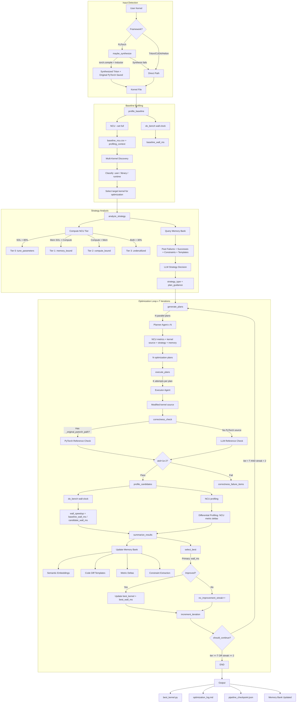
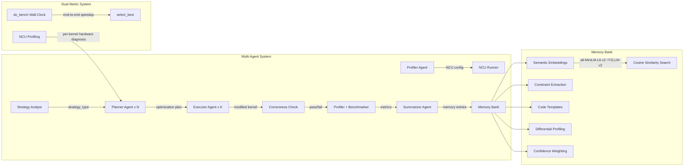
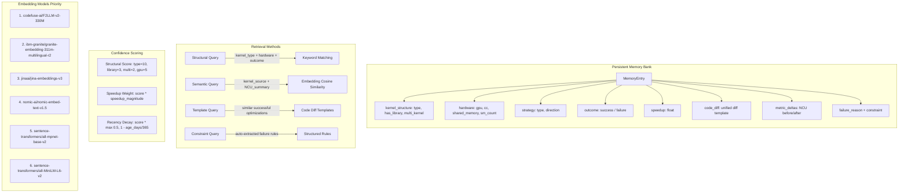
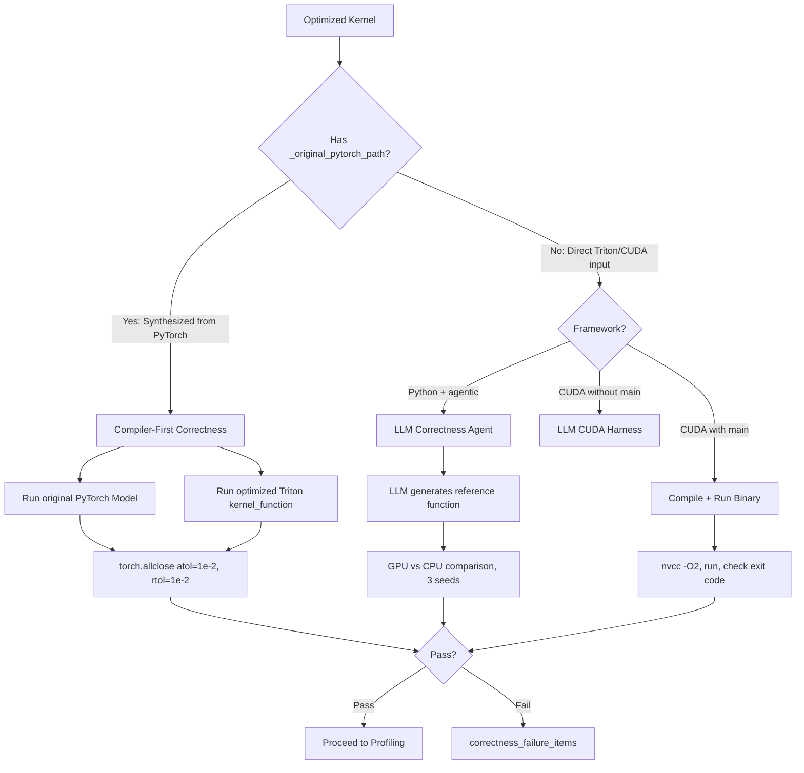
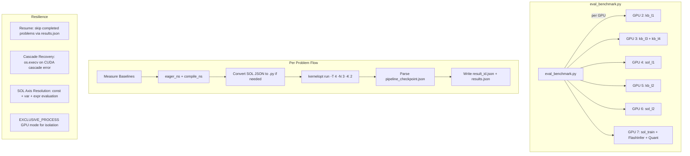

# kernelopt Architecture

## System Overview

kernelopt is a multi-agent GPU kernel optimization pipeline that takes any GPU kernel
(PyTorch, Triton, CUDA, Helion) and produces an optimized version using LLM-guided
hardware-aware optimization with NCU profiling.

**Core differentiators:**
- Compiler-first: uses `torch.compile` (Inductor) to synthesize Triton from PyTorch
- Dual metric: NCU for hardware diagnosis, wall-clock do_bench for speedup measurement
- Multi-kernel awareness: profiles ALL GPU kernels, optimizes the right bottleneck
- Semantic memory bank: learns from past runs with embedding-based retrieval
- Framework-agnostic: auto-detects PyTorch, Triton, CUDA, Helion

---

## Pipeline Flow



---

## Agent Architecture



---

## Memory Bank Architecture



---

## Correctness Verification



---

## NCU-Guided Optimization Tiers

| Tier | Condition | Strategy | Recommended Optimizations |
|------|-----------|----------|--------------------------|
| 0 | SOL% > 80% | `tune_parameters` | XBLOCK/num_warps/num_stages tuning, eviction hints |
| 1 | Memory SOL% > Compute SOL% | `optimize_kernel` (memory) | Coalescing, vectorized loads, L2 compression, tile locality |
| 2 | Compute SOL% > Memory SOL% | `optimize_kernel` (compute) | Register pressure, divergence, precision reduction |
| 3 | Both SOL% < 30% | `optimize_kernel` (rewrite) | Buffer elimination, pointwise fusion, algorithmic changes |

---

## Benchmark Runner Architecture



---

## File Structure

```
kernelopt/
├── cli.py                          # Typer CLI entry point
├── langgraph_pipeline.py           # LangGraph optimization pipeline
│   ├── maybe_synthesize            # PyTorch → Triton via torch.compile
│   ├── profile_baseline            # NCU + do_bench baseline
│   ├── analyze_strategy            # NCU-tier + memory-guided strategy
│   ├── generate_plans              # N parallel planner instances
│   ├── execute_plans               # K executor attempts per plan
│   ├── profile_candidates          # NCU + do_bench per candidate
│   ├── summarize_results           # Memory bank update
│   ├── select_best                 # Wall-clock primary metric
│   └── should_continue             # Loop control
├── state.py                        # PipelineState, GraphState, PlanCandidate
├── memory_bank.py                  # Semantic memory with embeddings
├── reference_kernels.py            # Triton tutorial reference database
├── agents/
│   ├── profiler/                   # NCU config + profiling
│   │   ├── __init__.py             # run_profiler_agent
│   │   └── ncu_runner.py           # NCU subprocess management
│   ├── planner/                    # Optimization planning
│   │   ├── __init__.py             # N-parallel planner orchestration
│   │   ├── prompts.py             # System prompt + diversity hints
│   │   └── tools.py               # query_profiling_context, search_memory
│   ├── executor/                   # Code modification
│   │   ├── __init__.py            # Executor agent
│   │   └── prompts.py            # System prompt + optimization guidance
│   ├── summarizer.py             # Experience summarization
│   ├── correctness.py            # LLM-based correctness verification
│   └── schemas.py                # Pydantic schemas for structured output
├── functions/
│   ├── benchmark.py              # Wall-clock do_bench (CUDA Events)
│   ├── correctness.py            # Correctness gate (PyTorch ref + LLM ref)
│   ├── compiler.py               # nvcc compilation
│   ├── csv_parser.py             # NCU CSV parsing + bottleneck discovery
│   └── gpu_monitoring.py         # GPU selection + activity monitoring
├── synthesis/
│   ├── compile_extract.py        # torch.compile → Triton extraction
│   └── wrap_kernel.py            # Wrap Inductor output for kernelopt
├── llm.py                        # LLM client (Anthropic / Vertex AI)
├── checkpoint.py                 # Pipeline checkpoint save/load
└── memory.py                     # Short-term optimization memory

eval_benchmark.py                 # Batch benchmark runner (531 problems)
launch_benchmark.sh               # tmux orchestrator for multi-GPU runs
collect_benchmark.py              # Result aggregation + report generation
```

---

## Key Design Decisions

1. **Compiler-first, LLM-second**: torch.compile generates correct Triton deterministically.
   The LLM only optimizes — never synthesizes from scratch.

2. **Dual metric system**: NCU diagnoses per-kernel hardware bottlenecks (what to fix).
   do_bench measures end-to-end wall-clock (whether the fix helped).

3. **Soft optimization boundary**: The LLM is guided to focus on @triton.jit kernels
   but retains context about library calls for informed decisions.

4. **Compiler-first correctness**: For synthesized files, the original PyTorch program
   is the ground truth — no LLM-generated reference needed.

5. **Semantic memory with constraint learning**: Embeddings enable `matmul+relu ≈ matmul+gelu`
   matching. Auto-extracted constraints prevent repeating known failures.

6. **Differential profiling**: Verifies the intended NCU metric actually changed after
   optimization, providing causal evidence not just correlations.
